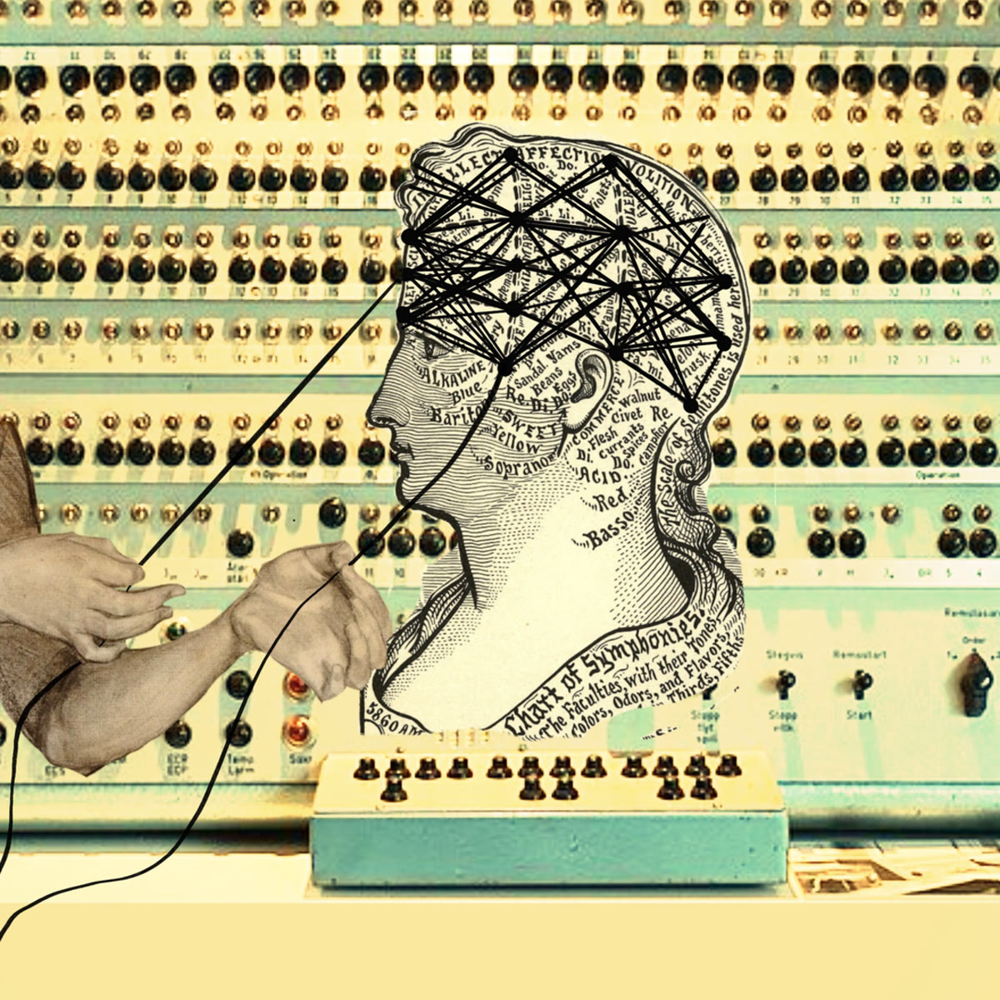
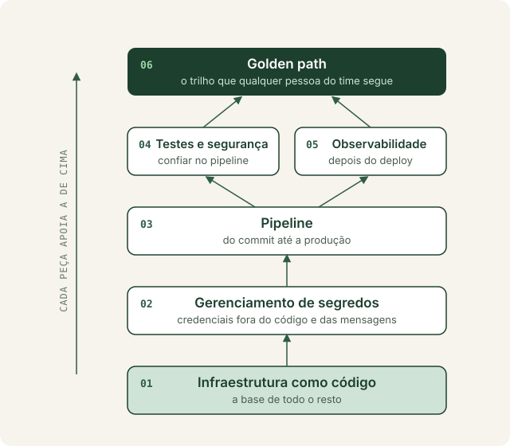

# Desenhando soluções ponta a ponta

*Hanna Barakat & Cambridge Diversity Fund, "Turning Threads of Cognition", [Better Images of AI](https://betterimagesofai.org) / [CC-BY 4.0](https://creativecommons.org/licenses/by/4.0/)*

Todos lutamos contra a força da entropia, e na engenharia de software não seria diferente. A quantidade de coisas que um engenheiro precisa manter na memória de trabalho é imensa: o código, os mecanismos internos de cada aplicação, como ela é implantada, onde ficam as credenciais, o que quebra se algo mudar.

Peter Naur, em *Programming as Theory Building* [1], argumenta que um programa não é só o código: é a teoria que vive na cabeça de quem o construiu, e essa teoria nunca se transfere por completo via documentação. Se isso é verdade, nosso trabalho não pode depender de cada pessoa reconstruir sozinha a teoria inteira do sistema antes de conseguir entregar algo com segurança.

Na prática, essa entropia tem nomes conhecidos. O primeiro é o **toil**: o trabalho manual, repetitivo e sem valor duradouro, aquele que precisa ser refeito a cada deploy, a cada ambiente novo, a cada pessoa que entra no time. O segundo é a **infraestrutura snowflake**: servidores e ambientes configurados à mão, cada um com suas particularidades, que ninguém sabe reproduzir e todos têm medo de tocar.

Os dois nascem do mesmo lugar: a falta de padronização. Sem um trilho bom por onde as aplicações possam correr, cada uma encontra o seu próprio caminho, e com o tempo vira uma peça frágil, resistente a mudanças e com pouca ou nenhuma previsibilidade. Mudar qualquer coisa passa a exigir que alguém reconstrua de cabeça a teoria inteira daquele sistema, exatamente o que Naur diz que não se transfere.

Some a isso a nova crise do software que estamos vivendo [2], em que produzimos código muito mais rápido do que conseguimos entendê-lo, testá-lo e operá-lo, e o resultado é um poço de ansiedade para quem precisa manter tudo de pé.

É aí que entra a plataforma. Uma boa plataforma interna de desenvolvimento reduz quanto dessa teoria cada desenvolvedor precisa carregar. As decisões difíceis (como provisionar infraestrutura, como guardar segredos, como algo chega à produção) ficam codificadas em ferramentas e caminhos padrão, em vez de espalhadas pela memória de algumas pessoas. *Team Topologies* [3] chama isso de reduzir a carga cognitiva das equipes.

Escrevo a partir da prática: sou o único engenheiro de plataforma de um time pequeno e montei nossa infraestrutura do zero. Muito do que vou compartilhar aqui veio de errar, refazer e documentar.

## A série

Esta é uma série semanal sobre como desenhar o ciclo de vida de desenvolvimento de software (SDLC), pensada tanto para desenvolvedores que querem entender a infra por trás do deploy quanto para quem está começando em plataforma. A ordem segue a dependência entre as peças:

1. **Infraestrutura como código:** a base sobre a qual todo o resto é construído
2. **Gerenciamento de segredos:** como tirar credenciais do código e das mensagens
3. **Pipeline:** o caminho do commit até a produção
4. **Testes automatizados e segurança:** o que precisa estar no pipeline para confiarmos nele
5. **Observabilidade:** o que acontece depois do deploy
6. **Golden path:** juntando tudo em um trilho que qualquer pessoa do time consiga seguir

O objetivo é construir esse trilho, peça por peça: menos toil, menos snowflake, menos deploy feito com medo e menos conhecimento que só existe na cabeça de alguém.

## Referências

[1] NAUR, Peter. *Programming as Theory Building*. Microprocessing and Microprogramming, v. 15, n. 5, 1985.

[2] O termo "crise do software" surgiu na conferência de engenharia de software da OTAN em 1968, cujo relatório foi editado por NAUR, Peter; RANDELL, Brian. *Software Engineering: Report on a conference sponsored by the NATO Science Committee*. Garmisch, 1968.

[3] SKELTON, Matthew; PAIS, Manuel. *Team Topologies*. IT Revolution, 2019.
